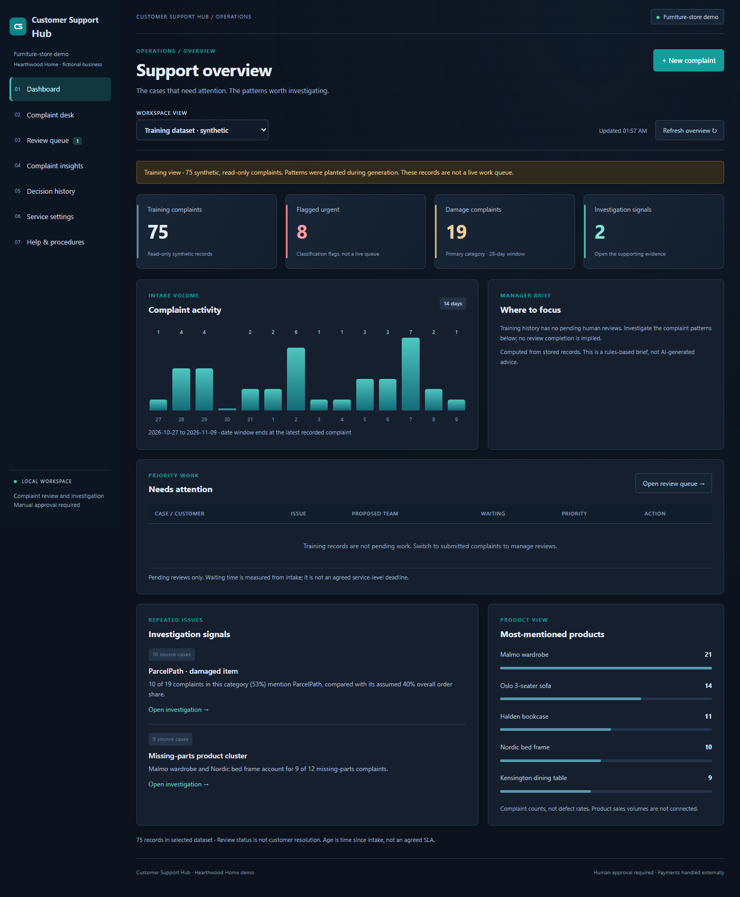
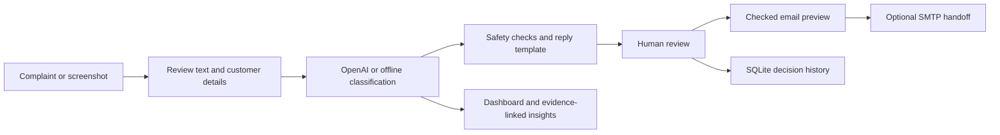

# Customer Support Hub



A local complaint review workspace for customer care teams.

**Demo configuration:** Hearthwood Home, a fictional UK furniture store. Product names, courier assumptions and reply signatures belong to this demo business; Customer Support Hub is the software. Record complaints, review suggested routes and replies, and investigate recurring issues using source evidence.

## Start the workspace

1. Install Python 3.10 or newer.
2. Open this folder in VS Code.
3. Run `python app.py` or `py -3 app.py` in the terminal. On Windows, `Start Customer Support Hub.cmd` also launches the service.
4. The browser opens automatically at http://127.0.0.1:8004. Keep the terminal open. Ctrl+C stops the server.

No third-party Python packages are required. VS Code launch configurations are included.

## Daily operations

The dark dashboard is the landing page. It shows pending reviews, urgent work, intake ageing, approved drafts, a 14-day activity chart, product counts and investigation signals. Every metric is computed from stored records. The training view remains separate and labelled.

- **Complaint desk:** enter the original message, customer email and known order details. Attach PNG/JPEG evidence or extract screenshot text for human checking. Classification creates a pending case.
- **Review queue:** search by customer, order, case ID or complaint text. Filter by status and urgency. Highest-urgency cases appear first. Check and edit the route and reply before approving or rejecting.
- **Complaint insights:** investigate submitted cases over a 28-day window. Open source complaints behind each signal. The optional training dataset is separate and synthetic.
- **Decision history:** inspect classification events, review changes and reviewer labels.
- **Service settings:** choose offline rules or an OpenAI connection. Session settings reset when the page is reloaded; server configuration can persist credentials privately.
- **Help & procedures:** operating instructions and escalation guidance.

Approval records a decision; it does not send automatically. Customer email requires an approved draft, a frozen preview, a checked recipient and an explicit send confirmation. Internal department handoffs use configured mailboxes and can be reviewed before a customer draft is approved. An optional SMTP connection is required. No external helpdesk assignment or refund execution is included.

Screenshot transcription uses the OpenAI image-input interface and requires private API credentials. AI text is editable and must be confirmed before triage. Product photos are kept as local evidence; they are not treated as proof of a defect and are not attached to emails in this version.

## Explore the demo

The app starts with a separate read-only training dataset of 75 synthetic complaints, accessible from the dashboard dataset selector. To populate the submitted-case queue with eight fictional examples:

```powershell
python app.py
# Stop the app with Ctrl+C after its first launch, then run:
python scripts/reset_demo_cases.py --replace-submitted
python app.py
```

The reset command **replaces existing submitted cases**, after saving a database backup under ignored `runtime/backups/`. It preserves the training dataset and connection settings. All demo cases use non-deliverable `.invalid` email addresses. Their intake dates are fictional; ageing metrics do not represent real operations. Start in offline rules mode without an API key. Gmail and OpenAI are optional connections.

## How it fits together



The model classifies and extracts. Reply text uses controlled templates. Suggested screenshot details are confirmed before replacing form values. SMTP acceptance is recorded separately from delivery; duplicate send attempts are blocked.

## Handover documents

- [User guide](docs/user-guide.md)
- [Email and image setup](docs/integrations.md)
- [Administrator handover and delivery scope](docs/handover.md)
- [Verification and known limitations](docs/verification.md)
- [Screenshots](docs/screenshots.md)

## Technical checks

Run `python -m unittest discover -s tests -v` for regression tests and `python scripts/evaluate.py` for the offline evaluation. Results describe synthetic development data, not guaranteed real-world performance. The 54 automated tests use mocked external services. User-run smoke checks demonstrated live OpenAI classification and screenshot transcription on individual examples. These are not a systematic accuracy evaluation. Live Gmail authentication and delivery still require a configured account and a controlled test.

Source is organised into `hearthwood/` (business logic), `web/` (interface), `data/` (synthetic fixtures), `tests/`, `scripts/` and `docs/`. Local records are stored in ignored `runtime/`. Never commit `.env`, API credentials or operational databases.

This delivery is a single-device local installation with manual intake and export. It does not include authenticated multi-user hosting. See the handover scope before using operational customer data.

Official API reference for image input: [OpenAI Images and vision](https://developers.openai.com/api/docs/guides/images-vision?api-mode=responses).

## Project status

Single-device portfolio demonstration with a fictional furniture-store configuration. It is not an authenticated multi-user helpdesk. Staff roles, named case ownership, inbox synchronisation, complaint resolution states and production deployment controls are outside the current scope. Known failures and test conditions are recorded in [verification](docs/verification.md).
